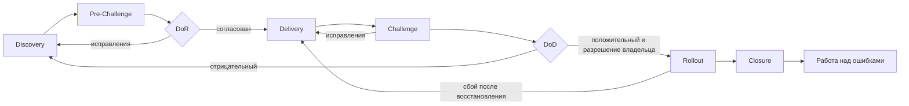

# Производственный процесс 0xExqui.OS 4.2

**Процесс — тоже часть продукта.** Я разрабатываю 0xExqui.OS с AI-агентами и использую этот процесс, чтобы доводить идеи до проверенного результата: от решения о границах до выпуска и разбора ошибок. Это правила для соло-разработки, а не готовая методика для любой команды.

## Версия 4.0: доработка по реестру проблем

3.1 (редакция от 28.09.2026) работала два месяца на реальных задачах. За это время в реестре проблем накопилось 11 открытых карточек с 23 повторами, а разбор показал, что правила в основном были, но не исполнялись: процесс стал слишком длинным, проверяющие сверяли отчёты, а не то, что видит владелец, и владелец первым находил ошибки после выпуска.

4.0 — не новый процесс, а доработка 3.1: те же фазы, роли и термины. Что изменилось:

- любая работа — поручение, задача, эпик или проект — получает подходящий по размеру цикл; режимов «пользовательский/инженерный» больше нет;
- brainstorming — первый обязательный шаг, до выбора решения;
- доклады DoR, DoD и итог закрытия готовит Product Owner по шаблонам языком пользователя; руководитель процесса проверяет текст до отправки;
- перед Challenge основной агент сам проходит шаги приёмки на компьютере и телефоне; Product Owner повторяет их со снимками; владелец смотрит проверочную версию до выпуска, а не после;
- роли вызываются по затронутому; CTO убирает лишние тесты и код и в Closure проверяет порядок репозитория: ветка слита, рабочие копии удалены;
- уровень рассуждений и skills назначены по фазам;
- редкие случаи вынесены в [ENGINEERING-REFERENCE.md](ENGINEERING-REFERENCE.md); текст, который агент читает в каждой задаче, короче на четверть.

Полный перечень из 44 изменений с ответом «было → стало» по каждой проблеме реестра — [AUDIT-3.1-4.0.md](AUDIT-3.1-4.0.md). 4.0 принята как действующая 16.11.2026 и не проверена пилотом: эффективность измеряется на первых работах.

[Скачать актуальную редакцию 4.2](https://github.com/0xParshikov/Product-Development-Process-by-0xParshikov/archive/refs/heads/main.zip) · [Открыть актуальные файлы](https://github.com/0xParshikov/Product-Development-Process-by-0xParshikov)

В выпуск входят [AGENTS.md](AGENTS.md) с правилами взаимодействия и ответственностью ролей, [ENGINEERING.md](ENGINEERING.md) с циклом работы, [ENGINEERING-REFERENCE.md](ENGINEERING-REFERENCE.md) с редкими случаями и [manifest.json](manifest.json) с контрольными суммами.

## Как процесс менялся

Каждая версия добавляла контроль там, где предыдущей не хватало. Даты показывают фиксацию правил, а не их применение в каждой задаче.

| Версия | Дата | Что изменилось |
| --- | --- | --- |
| 1.0 | 26.08.2026 | Первый управляемый путь от идеи до выпуска. |
| 2.0 | 02.09.2026 | Контрольные точки и границы доказательств. |
| 2.1 | 04.09.2026 | Роли, восемь фаз и автономная Delivery. |
| 2.2 | 05.09.2026 | EPIC-000, проверка и работа над ошибками. |
| 2.3 → 2.3.1 | 10.09.2026 | Superpowers, независимые роли и первый публичный пилот. |
| 2.4 | 12.09.2026 | Проект отделён от эпика; новый эксперимент. |
| 2.4.1 | 14.09.2026 | Учёт багов и четыре показателя; превосходство не доказано. |
| 2.4.2 | 17.09.2026 | Общие документы, пределы циклов и доклад DoD до выпуска. |
| 2.4.3 | 19.09.2026 | Ответственность основного агента и разбор разногласий ролей. |
| 2.4.4 | 19.09.2026 | Автор архитектурного дизайна и независимая проверка CTO. |
| 3.0 | 22.09.2026 | Полная сборка в Dev, независимые приёмщики, обязательное упрощение и ограничение проверок периметром изменения. |
| 3.1 | 28.09.2026 | Самостоятельная задача, автономный режим, переименование чата, исправление перед DoR. |
| 4.0 | 16.11.2026 | Типы работы вместо режимов, обязательный brainstorming, доклады языком пользователя, самопроверка до Challenge, роли по затронутому, порядок репозитория, справочник редких случаев. |
| 4.1 | 16.11.2026 | Уроки перевода проектов: проверка файлов вне Git перед удалением копии, сверка решений владельца при чистке PROJECT, `[CLOSED]` для поручений. Подробно — [CHANGES-4.0-4.1.md](CHANGES-4.0-4.1.md). |
| **4.2** | **16.11.2026** | **Разработка и проверка — в существующем Dev проекта, без отдельных адресов и стеков; Rollout переносит проверенную версию в целевой контур. Подробно — [CHANGES-4.1-4.2.md](CHANGES-4.1-4.2.md).** |

## От задачи до выпуска

Масштаб определяет цикл. **Поручение** не меняет продукт — данные, анализ, уборка, документы — и идёт без фаз и ролей. **Задача** — одно изменение продукта, **эпик** — до семи пользовательских историй, **проект** — несколько эпиков; все три проходят один и тот же цикл, задача — в меньшем объёме.

**DoR** фиксирует согласованные границы до реализации. В **Challenge** роли проверяют результат по своим областям; замечания возвращают работу в Delivery. **DoD** предъявляет владельцу подтверждённое и незавершённое до публикации. После разрешения следует **Rollout** — выпуск проверенной версии, затем **Closure** и независимый разбор ошибок. У EPIC-000 свой короткий цикл: Project Discovery → Project Challenge → DoR проекта → Closure → Работа над ошибками. Подробные условия переходов и возвратов находятся в [ENGINEERING.md](ENGINEERING.md).

## Один владелец. Шесть независимых ролей

| Роль | За что отвечает |
| --- | --- |
| Product Owner | Собирает истории и критерии, проверяет результат по пути пользователя. |
| CTO | Требует простого технического решения и независимо проверяет архитектуру. |
| Дизайн-директор | Сверяет интерфейс и текст с согласованным образцом. |
| Главный администратор | Проверяет доступ, запуск, состояние и восстановление. |
| CyberSec | Проверяет данные, доступы, секреты и состав публикации. |
| Руководитель процесса | Проверяет доклады владельцу до отправки и ведёт разбор ошибок. |

Роли не принимают решение вместо владельца и не проверяют собственную работу. Их точные полномочия описаны в [AGENTS.md](AGENTS.md).

## Карта документов

Общие правила живут в Платформе; цель и критерии — в проекте; детали реализации и доказательства — в текущем эпике.

| Уровень | Основные файлы | Назначение |
| --- | --- | --- |
| Платформа | `AGENTS.md`, `ENGINEERING.md`, `ENGINEERING-REFERENCE.md` | Роли, цикл работы и редкие случаи. Эти три файла опубликованы здесь. |
| Платформа | `ARCHITECTURE.md`, `NETWORK.md`, `DEPLOYMENTS.json`, `RISKS.md` и другие | Архитектура, размещение и рабочие реестры конкретной системы. В этот выпуск не входят. |
| Проект | `README.md`, `PROJECT.md`, `ROADMAP.md`, при необходимости `BUGS.md` | Работающие возможности, истории, порядок эпиков и открытые дефекты. |
| Работа | Документы проектирования и план реализации по Superpowers | Решение, план и ссылки из `PROJECT.md`. |

Файлы связаны назначением, а не выстроены в очередь. Новые документы появляются по мере необходимости; исторические снимки остаются в Git.

## «Маяк»: проверка изменений процесса

В лаборатории одну задачу проводят по двум версиям правил в изоляции, затем сравнивают результаты и следы работы. Смотрят на четыре показателя: **срок** до результата, **расход** токенов и известных затрат, **качество** по дефектам и переделкам, **прерывания** из-за незапланированного вмешательства владельца.

Проект показал, что синтетическая проверка отдельных механизмов не подтверждает пригодность полного решения. Поэтому 3.0 проводит Challenge на полной сборке. Отдельный пилот не доказывает, что версия процесса универсально лучше или подойдёт полноценной команде. [Подробнее о лаборатории и пилотах](https://0xexqui.com/process/#mayak).

## Как использовать комплект

1. Прочитайте `AGENTS.md` и `ENGINEERING.md` вместе.
2. Замените `<PLATFORM_ROOT>` на корень своей Платформы и подготовьте документы своего проекта, перечисленные в `ENGINEERING.md`.
3. Подключите правила к своему AI-инструменту. Навыки Superpowers устанавливаются отдельно.
4. Соотнесите проверки, документы и права доступа со своей средой: архитектура, сеть, рабочие реестры и правила интерфейса 0xExqui.OS не входят в этот комплект.

Публичная копия сохраняет правила версии 4.0. В ней заменён локальный путь Платформы; внутренние документы и реестры не публикуются. Исходные контрольные суммы и перечень изменений указаны в [manifest.json](manifest.json).
